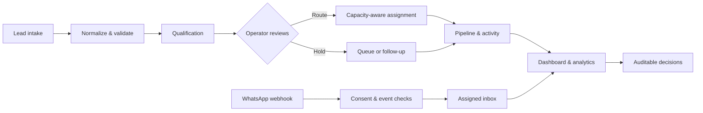
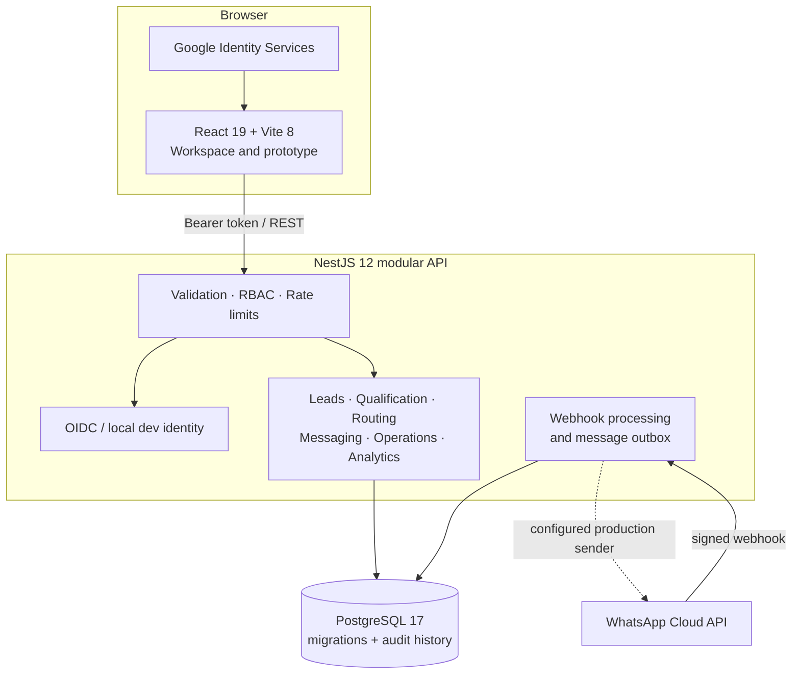

<div align="center">
  
  <br />
  <a href="https://github.com/arazik-code/Lead-Executive/actions"></a>
  
  
  
  
  
  <h1>Executive Lead Control</h1>
  <p><strong>A deliberate operating system for lead intake, qualification, assignment, and customer conversations.</strong></p>
  <p>Internal CRM · Single organization · One WhatsApp account · Google Workspace identity</p>
</div>

<br />

> **Project status** &nbsp; The core product and modular API are implemented. The local seeded walkthrough is ready to run with Docker Compose. Production setup still requires organization credentials, policy decisions, a managed database, and deployment configuration; see [readiness](#production-readiness) before launch.

## The operating model

Executive Lead Control brings the lead lifecycle into one accountable workspace. Teams can understand where an opportunity came from, what information supports its qualification, why an assignment was made, and what happened next.



## Product surface

| Workspace | What it does | Control built into the workflow |
|:--|:--|:--|
| **Lead register** | Intake, search, filters, editing, archive, activity timeline | UAE phone normalization, duplicate checks, organization scope, role-aware visibility |
| **CSV operations** | Review and import batches; export filtered records | Preview before commit, row-level feedback, provenance, audit trail, formula-injection protection |
| **Qualification** | Versioned forms, typed answers, explainable score snapshots | Immutable published versions and idempotent answer submission |
| **Routing** | Agent capacity, availability, specialties, regions, policy versions | Dry-run preview; explicit operator action; locked capacity check and recorded explanation |
| **Pipeline** | Stage distribution and lifecycle transitions | Invalid transitions rejected; changes and assignment history audited |
| **WhatsApp inbox** | Conversation history, unread state, ownership and handoff | Signed webhook, deduplication, recorded opt-in, reply-window checks and guarded outbox |
| **Dashboard & analytics** | Role-scoped operational metrics and date-bounded cohorts | Aggregates derive from persisted organization data and lifecycle history |
| **Team & settings** | Member provisioning, roles, organization defaults, preferences | Verified Workspace identity; server-authoritative role and active state |
| **Search & notifications** | Search leads and conversations; follow event links | Scoped results, escaped query wildcards, user-owned notification state |

<details>
  <summary><strong>Engineering highlights</strong></summary>
  <br />

  - NestJS modular monolith with explicit feature modules and typed request validation.
  - PostgreSQL source of truth; ordered SQL migrations carry checksums and reject drift.
  - Transactional lead writes pair the record with lifecycle, audit and notification events.
  - Google OIDC verifies tokens and Workspace email; role and membership checks stay server-side.
  - WhatsApp webhooks verify signatures and deduplicate provider events; outbound work is queued through a bounded retry outbox.
  - A local-only development identity and synthetic demo seed keep the walkthrough independent of Google and Meta credentials.
  - React 19, TypeScript and Vite 8 web client with an API-backed authenticated workspace and a separate prototype experience.
- The landing-page WebGPU example is pinned and attributed; see [third-party notices](THIRD_PARTY_NOTICES.md).
</details>

## Architecture



<p align="center"><sub>One deployable API with clear domain boundaries; PostgreSQL owns durable CRM state. Provider calls stay behind server-side configuration.</sub></p>

### Stack at a glance

| Layer | Technology |
|:--|:--|
| Web | React 19.3 · TypeScript · Vite 8 · React Router · Tailwind CSS · Radix UI |
| API | Node.js 24.15+ · NestJS 12 · TypeScript · class-validator · OpenAPI |
| Data | PostgreSQL 17 · SQL migrations · transactional services · `pg_trgm` search |
| Identity | Google Identity Services · OIDC JWT verification · Workspace-domain allow-list |
| Messaging | WhatsApp Cloud API webhook/outbox integration (credentials intentionally not included) |
| Local demo | Docker Compose · Nginx · synthetic deterministic seed |
| Quality | TypeScript checks · ESLint · API unit tests · GitHub Actions workflow |

## Run the complete demo

The quickest route is the local Compose profile. It builds the web app and API, starts PostgreSQL, applies migrations, creates the development-only identity, and loads synthetic CRM records.

**Requirements:** Docker Desktop with Compose, Node.js 24.15+, and pnpm 11.

```bash
git clone https://github.com/arazik-code/Lead-Executive.git
cd Lead-Executive
docker compose -f docker-compose.yml -f docker-compose.demo.yml --profile demo up --build
```

Open **[http://localhost:8080](http://localhost:8080)** and choose **Sign in to local API**. The seeded local identity is `local-admin`; it is a development header identity, not a password. The demo uses generated sample records, requires no Google or WhatsApp credentials, and makes no Meta provider calls.

For a guided recording flow, sample import file, reset steps, and the demo's safety boundaries, see [`docs/DEMO_RUNBOOK.md`](docs/DEMO_RUNBOOK.md).

<details>
  <summary><strong>Run the web client and API separately</strong></summary>
  <br />

  Start the database:

  ```bash
  docker compose up -d postgres
  ```

  Configure the API:

  ```bash
  # PowerShell
  Copy-Item apps/api/.env.example apps/api/.env
  ```

  Install dependencies and start the API:

  ```bash
  pnpm install --frozen-lockfile
  pnpm --dir apps/api install
  pnpm --dir apps/api db:migrate
  pnpm --dir apps/api db:seed:development
  pnpm --dir apps/api start:dev
  ```

  In a second terminal, start the Vite web client:

  ```bash
  pnpm dev
  ```

  API base URL, browser auth mode, and Google client ID are configured with the `VITE_*` variables documented in [`.env.example`](.env.example). Keep development auth local only. API reference: `http://localhost:4000/api/docs`; liveness and readiness: `/api/v1/health/live` and `/api/v1/health/ready`.
</details>

## Repository map

```text
.
├── apps/api/                 NestJS API, SQL migrations, seeders and unit tests
├── src/                      React application, workspace screens and shared UI
│   ├── components/           Auth, dashboard, lead, routing and messaging UI
│   ├── lib/                   API client helpers and WebGPU radiance renderer
│   └── pages/                 Landing page and prototype routes
├── agent-radiance-cascades/  Pinned upstream example source and provenance
├── docs/                     Demo runbook, implementation status and sample CSV
├── deploy/                   Nginx reverse-proxy configuration
├── .github/workflows/        CI workflow
├── docker-compose*.yml       Local database and complete seeded demo
└── Dockerfile.web            Web image build
```

## Checks and local development

```bash
pnpm build                         # web typecheck + production bundle
pnpm lint                          # web lint
pnpm --dir apps/api typecheck      # API typecheck
pnpm --dir apps/api build          # API production build
pnpm --dir apps/api test           # API unit tests
```

The CI workflow also exercises PostgreSQL migrations and the synthetic seed against PostgreSQL 17. Run those checks in a Docker-enabled environment; a successful web build alone does not validate a live database or external provider setup.

## Production readiness

This repository is an actively developed internal CRM foundation. Treat these as launch gates, not configured product defaults:

- Configure the Google OAuth **Web Client ID**, exact Workspace domain and allowed HTTPS origins. Provision members in Team before sign-in.
- Provision a managed PostgreSQL database, managed secrets, backups, restore checks, network restrictions and an operational deployment host.
- Configure a Meta app, WhatsApp Business account/number, access token, public webhook, approved templates and retention/consent policies before enabling messaging.
- Approve qualification weights, score thresholds, lifecycle policy, routing behavior and the lawful basis for imported contact data. Current scoring/routing examples are deterministic and need business calibration.
- Run migrations against a reviewed target database; migration 008 deliberately stops for active-phone duplicates that require resolution.
- Add database integration and end-to-end coverage, observability, performance review and incident runbooks before calling the service production-ready.

**Demo safeguards:** the sample seed refuses production mode, non-development authentication, missing explicit `DEMO_SEED=1`, or configured WhatsApp credentials. Seed-tagged contacts have no implied consent and outbound sending is blocked. Never run the demo seeder against real lead data.

See [`docs/IMPLEMENTATION_STATUS.md`](docs/IMPLEMENTATION_STATUS.md) for the detailed delivered scope, verification record and remaining dependencies.

## Data handling

The repository contains no customer/prospect dataset. CSV import records provenance and reports validation and duplicates; it does **not** infer consent or lawful processing basis. Review organizational policy and access controls before importing real contact information. Keep secrets in a secret manager or ignored local environment files—never in commits.

## Security notes

- Production startup rejects local auth, missing OIDC/domain configuration, wildcard or non-HTTPS CORS origins, and partial WhatsApp credentials.
- Membership, roles, organization scope and record visibility are checked by the API.
- The local Compose database password and development identity are for local use only.
- Report security issues privately to the repository maintainers; do not publish exploit details in an issue.

## License

Proprietary internal software. No open-source license is granted by this repository.

<div align="center">
  <sub>Built for deliberate decisions, visible reasoning, and accountable follow-through.</sub>
</div>
